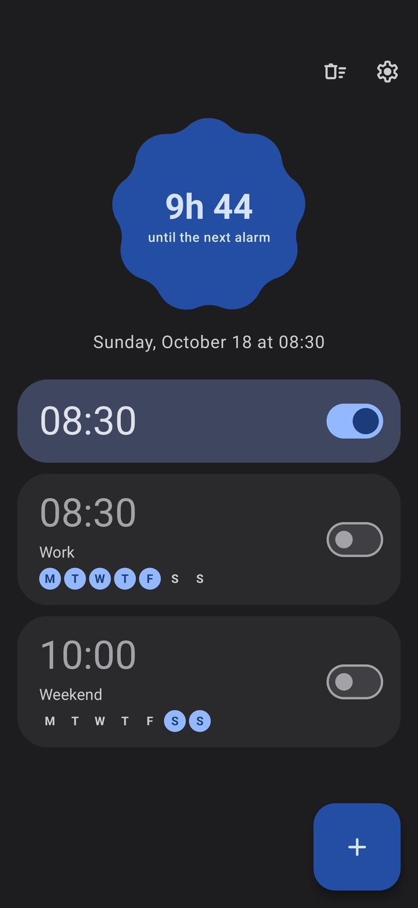
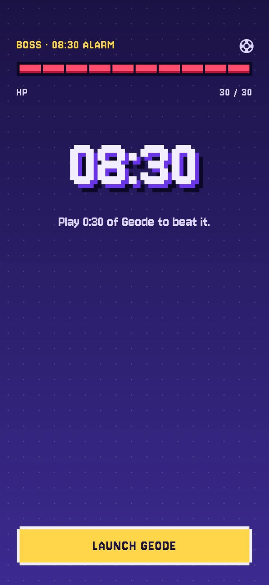
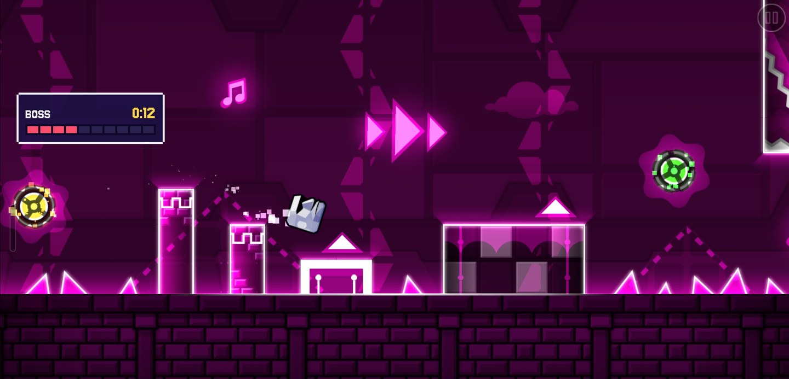

# Respawn Alarm

An alarm clock you can only stop by playing. When it rings, you have to actively play a game of your choice for a set time, without a break. If you don't the alarm goes back on. It was made to wake up with a few minutes of Geometry Dash, but it works with any app.

<p align="center">
  <a href="fastlane/metadata/android/en-US/images/phoneScreenshots/1.jpg"></a>
  <a href="fastlane/metadata/android/en-US/images/phoneScreenshots/2.jpg"></a>
  <a href="fastlane/metadata/android/en-US/images/phoneScreenshots/3.jpg"></a>
</p>

## How it works

- Set the alarm.
- When it rings and you try to stop it, it opens the target app.
- The alarm stops ringing while the target app is in the foreground **and** you keep touching the screen.
- Play time builds up from there. Leave the app, or stop touching the screen for longer than the inactivity limit, and the counter goes back to zero and the alarm rings again.
- Once you have played for the whole duration, the alarm is done.

## How it knows you are playing

- **Which app is in the foreground:** the usage events log (`UsageStatsManager`), hence the "Usage access" permission.
- **Whether you touch the screen:** Respawn Alarm puts a 1×1 px transparent window over other apps, which Android notifies each time a finger goes down anywhere on screen (`FLAG_WATCH_OUTSIDE_TOUCH`). Android hides where the touch landed; the app only learns that there was one. This needs the "Display over other apps" permission.

## Install

<a href="https://apps.obtainium.imranr.dev/redirect?r=obtainium://app/%7B%22id%22%3A%22io.github.elaaps.respawnalarm%22%2C%22url%22%3A%22https%3A%2F%2Fgithub.com%2FElaaps%2FRespawn-Alarm%22%2C%22author%22%3A%22Elaaps%22%2C%22name%22%3A%22Respawn%20Alarm%22%7D"></a>

You can also grab the APK from the [Releases](https://github.com/Elaaps/Respawn-Alarm/releases) page.


## Limitations

- A touch is counted when a finger goes down. Holding a finger down without lifting it counts as inactivity.

## Build

```sh
echo "sdk.dir=$HOME/Android/Sdk" > local.properties
./gradlew testDebugUnitTest assembleDebug
```

## License

[GPL-3.0](LICENSE)

The [Jersey 10](https://github.com/scfried/soft-type-jersey) font is under the [SIL Open Font License 1.1](app/src/main/assets/licenses/OFL-Jersey10.txt).
